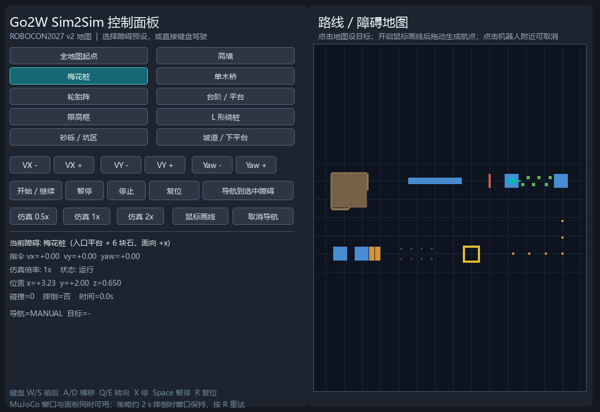
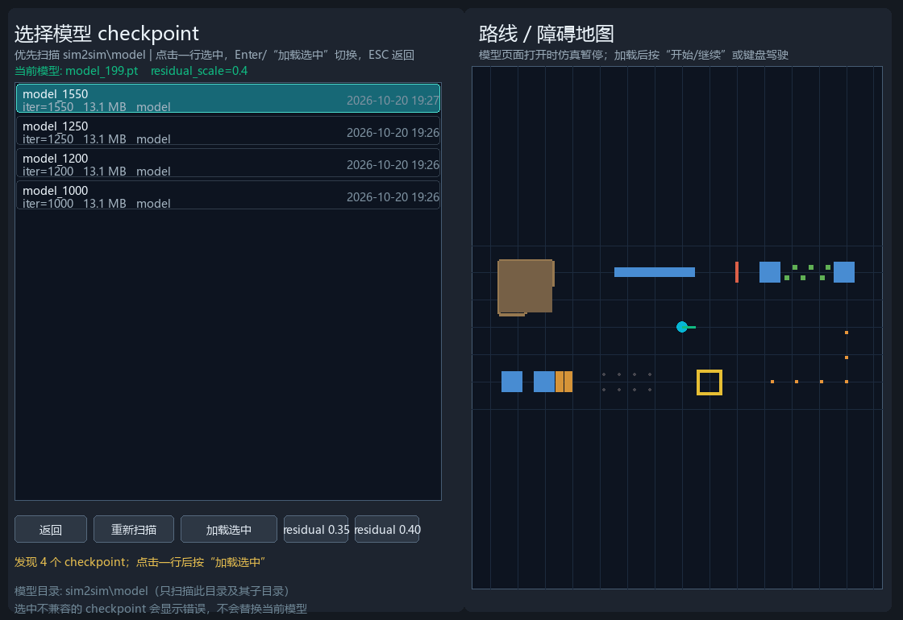

# sim2sim — 积木式 MuJoCo sim2sim 验证框架

这是 `HighTorque-MiniDog/mujoco/sim2sim` 的积木式重构版本。目标不是只改一条命令，而是把
“机器人 / 策略 / 观测 / 障碍 / 判定 / 批量评估”拆成可独立替换的积木，先保证**推理契约和
训练完全一致**，再回答“这个 checkpoint 能不能过障碍”。

当前结论见 [FINDINGS.md](FINDINGS.md)：`model_199.pt` 是一个 199 iteration 的 Mixed 冒烟
checkpoint，只在平地上能稳定前进；梅花桩、高墙、台阶、rough、沟壑均未通过（最小的 10 cm
沟壑可以通过）。

> 2026-10-19 已通过管理员脚本合并到
> `D:\mujoco_test\HighTorque-MiniDog\mujoco\sim2sim`，原目录现在是主运行位置。
> `D:\mujoco_test\sim2sim_next` 保留为源副本/迁移工作区。重新同步或排查权限问题见
> [MIGRATION.md](MIGRATION.md)。

---

## 1. 快速开始

下面的命令都使用已经装好 `torch/mujoco` 的 MJLab 环境。

如果你在 **cmd.exe**（提示符是 `D:\...>`），不要用 `$py` 和 `&`；直接用包装脚本：

```bat
cd D:\mujoco_test\HighTorque-MiniDog\mujoco\sim2sim
sim2sim.cmd
sim2sim.cmd selfcheck
sim2sim.cmd eval --suite configs\suites\quick.yaml --out results\quick
sim2sim.cmd run --obstacle plum --difficulty 0.35
```

- `sim2sim.cmd` 不带参数会直接打开 **v2 ROBOCON 地图 + 控制面板**；
- `sim2sim.cmd run ...` 默认也打开 viewer（使用 `configs/go2w.yaml`，可用 `--config` 切换）；
- 只有 `selfcheck`、`eval`、`build` 和加了 `--headless` 的 `run` 是无窗口的。

### v2  ROBOCON 地图 + UI

```bat
cd D:\mujoco_test\HighTorque-MiniDog\mujoco\sim2sim
course.cmd
```

等价写法是 `sim2sim.cmd run --config configs\course.yaml --duration 0`。

这会同时打开：

- MuJoCo 物理窗口；
- pygame 控制面板：左侧选择障碍（高墙、梅花桩、单木桥、轮胎阵、台阶、限高框、L 形绕桩、砂砾坑、坡道），
  右侧是 v2 地图；
- 键盘 W/S/A/D/Q/E/X、Space、R；
- 地图点击设导航目标，开启“鼠标画线”后拖动生成航点；
- “导航到选中障碍”按钮会先自动接近该障碍入口，之后可随时用键盘接管；
- VX/VY/Yaw 按钮、仿真 0.5x/1x/2x、暂停/继续/停止/复位。

`--duration 0` 表示不限时；关闭窗口退出。`--no-panel` 只开 MuJoCo 窗口。
地图文件在 `configs/course.yaml` 的 `obstacle.params.xml` 中指定，默认
`D:\mujoco_test\robocon2027.v2.xml`。



### UI 内切换模型

在面板右上角点 **“选择模型”**，会展开 checkpoint 选择页：

- **只扫描** `D:\mujoco_test\HighTorque-MiniDog\mujoco\sim2sim\model`
  （可建子目录，建议命名 `model_<iteration>.pt`）；
- 把一个或多个 `.pt` 放进去后，点“重新扫描”；
- 点击一行选中，再用 **“加载选中”** 或 `Enter` 切换；
- 可切 `residual 0.35`（PlumBlossom）和 `0.40`（Mixed）；
- 不兼容的 checkpoint（12-DoF MiniDog、scan 216、history 不同）会显示错误，并保留当前模型；
- 打开选择页会暂停仿真；返回/加载成功后恢复运行，不会一直停在暂停。



PowerShell 写法：

```powershell
$py = "D:\mujoco_test\HighTorque-MiniDog\mujoco\mjlab\.venv\Scripts\python.exe"

# 0) 列出可用的机器人 / 障碍 / 判定器
& $py sim2sim.py list

# 1) 只组合场景，不跑策略（检查 XML、几何、出生点）
& $py sim2sim.py build --obstacle stairs --difficulty 0.5

# 2) 跑一个 episode（无窗口）
& $py sim2sim.py run --headless --obstacle flat --duration 15

# 3) 跑一个完整评估矩阵，输出 JSON/CSV/Markdown
& $py sim2sim.py eval --suite configs/suites/full.yaml --out results\my_run

# 4) 打开查看器
& $py sim2sim.py run --obstacle plum --difficulty 0.35
```

`run` 默认使用 [configs/go2w.yaml](configs/go2w.yaml)。切换到 MiniDog：

```powershell
& $py sim2sim.py run --config configs/minidog.yaml `
  --checkpoint <path-to-minidog-model.pt> --obstacle flat --headless --duration 15
```

兼容旧命令行（没有子命令、旧 `config.yaml` 字段）：

```powershell
& $py sim2sim.py --headless --config <old-config.yaml> --checkpoint <model.pt> `
  --command 0.25 0 0 --duration 15 --spawn 0 0 0.45 0
```

旧的 `--course` 也保留，会切到 `course` 积木：

```powershell
& $py sim2sim.py run --config configs/course.yaml --headless --duration 20
```

---

## 2. 积木架构

```
sim2sim.py                    # 薄入口，向后兼容旧参数
dogsim/
  config.py                   # YAML -> 强类型配置，路径/维度/范围校验
  robots.py                   # 机器人 profile：关节顺序、增益、默认姿态、扫描尺寸
  scene.py                    # 机器人 + 一个障碍积木 -> MJCF -> 校验后的 MjModel
  observation.py              # 本体观测项、term-major 历史、10 Hz 高度扫描
  simulation.py               # 唯一的步进循环（不关心具体障碍/策略）
  randomization.py            # reset-time 域随机化
  viewer.py                   # MuJoCo viewer + pygame 面板集成
  panel.py                    # v2 地图、障碍预设、鼠标导航、键盘控制
  navigation.py               # 航点控制器
  cli.py                      # run/eval/build/list/selfcheck
  obstacles/
    base.py                   # ObstacleModule / BuildContext / ObstacleBuild / Feature
    registry.py               # 共享注册表
    flat.py rough.py plum.py
    high_wall.py gap.py stairs.py low_bar.py course.py
  policies/
    base.py                   # PolicyBackend / PolicyContract
    ame.py                    # AME + 4 通道 radar + top-k residual MoE
    mlp.py                    # 旧版 flattened-history MLP
    loader.py                 # checkpoint 检查、形状推断、严格加载
  evaluators/
    base.py metrics.py        # 稳定退出、接触、进度等公共判定
    flat.py rough.py plum.py
    high_wall.py gap.py stairs.py low_bar.py course.py
  suite.py                    # 矩阵运行 + JSON/CSV/Markdown 报告
configs/                      # 机器人/课程/评估矩阵
tests/                        # 16 个契约、扫描、几何、判定、UI、模型选择、集成测试
```

几条硬边界：

- `simulation.py` 不 import 任何具体障碍或具体策略；
- 每个 `obstacles/*.py` 只接收 `worldbody` 和 `BuildContext`，返回出生点、目标距离、
  命名特征，不读取策略；
- 每个 `evaluators/*.py` 只读取 `StepState` 和 `ObstacleBuild`；
- 新增障碍 = 新增一个 obstacle brick + 一个 evaluator brick，其他文件不动。

### 2.1 障碍积木的接口

```python
class MyObstacle(ObstacleModule):
    type = "my_obstacle"
    default_params = {...}
    def build(self, ctx: BuildContext) -> ObstacleBuild:
        body = ctx.body("lane")
        add_box(body, "my_geom", ...)
        return ObstacleBuild(
            type=self.type,
            spawn=(x, y, z, yaw),
            terrain_origin=(x, y, z),
            success_distance=4.0,
            features=[Feature(name="my_feature", kind="...", ...)],
            lane_width=2.4,
            metadata={"difficulty": ctx.difficulty},
        )
```

注册：

```python
from .registry import OBSTACLES
OBSTACLES.register("my_obstacle", MY_OBSTACLE)
```

---

## 3. 障碍与难度映射

难度 `d ∈ [0, 1]` 与训练 `TerrainGeneratorCfg` 的 6 行 difficulty 一致：

| brick | 参数映射（训练同源） | 备注 |
|---|---|---|
| `flat` | 10 m × 4 m 平地，目标 4 m | 基线 |
| `rough` | 0.4 m 网格，高度 0–0.08 m（d=0）→ 0.02–0.30 m（d=1） | 与训练 `BoxRandomGridTerrainCfg` 同量级；训练里另有 hfield rough |
| `plum` | block 0.36→0.12 m，高 0.10→0.32 m，平台 0.14→0.28 m | 两排三块，入口平台 + 2.7 m 出口 |
| `high_wall` | 墙高 0.06 / 0.08→0.42 m，3 道，厚 0.05 m | d<0.1 仍保留 0.06 m 最小墙，避免“无障碍”假通过 |
| `gap` | 宽 0.10→0.65 m，深 0.04→0.45 m | 可见沟底，不能无限掉落 |
| `stairs` | 4 级，踏步高 0.04→0.32 m，踏面 0.32 m，顶部平台 | 训练 `pyramid_stairs` 的方向化版本 |
| `low_bar` | 净空 0.34→0.24 m，6 根横杆 | 可选 |
| `course` | 直接组合 `ROBOCON2027.xml` | 端到端兼容/目视检查，默认用通用 progress 判定 |

`configs/suites/`：

| suite | 用途 |
|---|---|
| `flat.yaml` | 平地基线 |
| `flat_stress.yaml` | 平地 + 域随机化 5 次 |
| `quick.yaml` | 6 个代表难度，约 1 分钟 |
| `easiest.yaml` | 每个障碍的 d=0（“会不会这个技能”） |
| `full.yaml` | 5 类 × 5 难度 + flat，24 个 episode |

---

## 4. 判定语义

一个 episode 只有在**障碍事件 + 连续 5 个策略步的稳定退出**同时成立时才是 PASS：

- 障碍事件：
  - `plum`：完成一排 3 块石头（默认，训练 `require_all_stones=False`；可配成 6 块），
    每块需要 2 个连续策略步的有效顶部接触；
  - `high_wall`：3 道墙都必须在墙宽范围内被跨过；
  - `gap`：必须跨过远侧边缘；
  - `stairs`：必须到达顶部平台；
  - `rough/flat`：达到目标距离。
- 稳定退出：不摔倒、倾角 < 0.70、相对高度 > 0.14 m、前向速度 > 0.02 m/s、
  垂直速度 < 0.75 m/s、有足/轮支撑、无 base/thigh/trunk 与地形碰撞。
- **calf/shank 接触是允许的**：训练的成功条件明确允许轮/小腿贴边爬升；旧 sim2sim 把它
  算成 illegal，导致上台阶/上石头被误判。
- 摔倒、base/thigh 碰撞、偏离赛道、超时都是 FAIL；checkpoint/资产/维度错误是 ERROR。

输出：

- `results.json`：每个 episode 的完整指标和特征；
- `summary.csv`：一行一个 episode；
- `report.md`：聚合表 + episode 表 + 判定说明。

---

## 5. 测试

```powershell
& $py -m unittest discover -s tests -v
```

16 个测试覆盖：

- checkpoint 契约（MoE/AME/MLP、16/12 动作、354/282 本体、403/216 扫描）；
- **推理副本与训练 `AMEProprioActor` 的 forward 逐元素一致**（当前 MoE 最大误差 0.0）；
- 高度扫描为正、10 Hz 保持、历史长度；
- 每个障碍 brick 都能组合并加载；
- 判定器的 PASS / 绕过墙不给分 / 梅花桩按排完成；
- `model_199.pt` 平地 4 m 集成测试；
- v2 地图 UI：障碍几何、场景切换、键盘/导航命令；模型选择页与 catalog。

---

## 6. 与旧 sim2sim 的差异

旧目录 `HighTorque-MiniDog/mujoco/sim2sim` 当前是只读 ACL（详见
[MIGRATION.md](MIGRATION.md)），因此新代码放在 `D:\mujoco_test\sim2sim_next`。旧版有几处
会直接导致结论错误的问题：

1. **radar encoder 3 通道 vs checkpoint 4 通道**：当前 MoE checkpoint 直接加载失败；
2. **高度扫描符号反了**：返回 `-distance`，平地约 -0.45 m，训练是 +0.45 m；
3. **MoE 融合方式不同**：旧版把 3 个 expert 全部加权，训练是 wheel + argmax residual、
   residual_scale=0.40、last_action/输出 clamp ±4；
4. **扫描保持频率不同**：旧版每 2 个策略步刷新（25 Hz），训练是 10 Hz（每 5 步）；
5. **物理选项不同**：旧版 Euler/pyramidal/impratio=1，训练是 implicitfast/elliptic/impratio=100；
6. **旧版没有台阶/rough 判定**，梅花桩要求全部 6 块，且把 calf 接触算 illegal；
7. **旧版测试障碍尺寸是手写的**，与训练 `terrain.py` 的难度映射不一致。

这些修复后，`model_199.pt` 在平地上从“几乎不动”变为稳定前进 4 m；但障碍结论仍然是
FAIL——这不是仿真误差，而是策略确实没有学过抬腿/越障。

---

## 7. 限制

- 交互查看器保留 W/S/A/D/Q/E/X/R，旧 pygame 面板没有移植；评估以 headless/suite 为主。
- `course` 模式是端到端兼容和目视检查，默认只做通用 progress + 稳定退出；逐障碍判定请用
  独立 brick（`high_wall`/`stairs`/`plum`/`gap`/`rough`）。
- `rough` 用 block field 近似训练中的 hfield rough；两者量级一致，但不是同一高度场。
- MiniDog 12-DoF 的 MLP 路径可以加载旧 checkpoint，但当前手头的 `plum_v2` 模型在旧版和
  新版 sim2sim 中都不会前进，说明该 checkpoint 本身/其训练契约还有待核对；不要用它做
  本框架的正向对照。

---

## 8. 下一步建议

1. 不要把 `model_199.pt` 当作可部署的障碍策略；它是 199 iteration 的冒烟模型。
2. 按课程逐段训练并在每段用对应 suite 做 gate：
   `flat` → `rough 0.4` → `stairs rise≈0.12` → `gap 0.3` → `wall 0.15` → `plum 0.4` → `mixed`。
3. 先解决“腿不动”的问题：当前策略在 4 cm 台阶、6 cm 墙前就停下，说明 12 个腿关节没有
   形成抬腿/支撑行为；检查 leg action scale、pose/gait 奖励、wheel/leg 动作耦合。
4. 每 50–100 iteration 用 `configs/suites/quick.yaml` 评估一次，记录 `PASS/FAIL` 和
   `max_tilt/min_z/illegal`，不要只看 reward。
5. 用 `configs/suites/flat_stress.yaml` 或 `--randomize` 做域随机化，平地已经 5/5 PASS，
   可以把随机化范围继续加宽。
